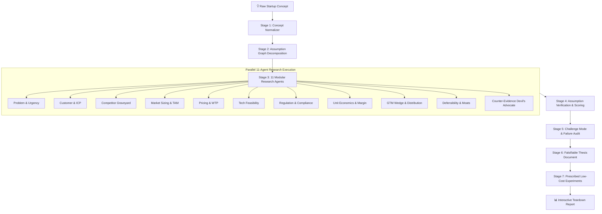

<div align="center">

# ⚡ Startup Idea Validator (BYOK)
### *Stress-test early concepts against actual market friction, distribution bottlenecks, and unit economics before a single line of production code gets written.*

<br/>

[](https://github.com/akhilyad/Startup-Idea-Validator-BYOK/stargazers)
[](https://github.com/akhilyad/Startup-Idea-Validator-BYOK/network/members)
[](LICENSE)
[](#-byok-economics--cost-comparison)
[](#-privacy--local-first-guarantee)
[](https://github.com/akhilyad/Startup-Idea-Validator-BYOK/actions)
[](https://www.typescriptlang.org/)
[](https://turbo.build/)
[](CONTRIBUTING.md)

<br/>

[🚀 Quickstart](#-quickstart-in-under-2-minutes) • [⚡ 11-Agent Research Engine](#-the-11-agent-deep-research-engine) • [💰 BYOK Cost Breakdown](#-byok-economics--cost-comparison) • [📐 System Architecture](#-architecture--monorepo-structure) • [🔒 Privacy & Security](#-privacy--local-first-guarantee) • [🤝 Contributing](#-contributing)

</div>

---

> [!IMPORTANT]
> ### 💡 Why This Project Exists
>
> *"I got tired of watching founders spend months building MVPs for problems nobody has—and equally tired of generic AI wrappers charging $30/month just to pass a prompt to OpenAI.*
>
> *I built **Startup Idea Validator BYOK** to stress-test early concepts against actual market friction, distribution bottlenecks, and unit economics before a single line of production code gets written.*
>
> * **Bring Your Own Key (BYOK):** Zero markup. Plug in your own OpenAI, Anthropic, or OpenRouter key and pay fractions of a cent per teardown.
> * **Unforgiving feedback:** It doesn't validate your ego. It actively looks for distribution traps, low willingness-to-pay, and incumbents that will crush you.
> * **Local and private:** Your ideas and API keys stay in your browser. Nothing touches a third-party database."*

---

## 📑 Table of Contents

- [The Problem with "AI Idea Validation"](#-the-problem-with-ai-idea-validation)
- [Core Pillars](#-core-pillars)
- [How It Works: The Validation Pipeline](#-how-it-works-the-validation-pipeline)
- [The 11-Agent Deep Research Engine](#-the-11-agent-deep-research-engine)
- [BYOK Economics & Cost Comparison](#-byok-economics--cost-comparison)
- [Architecture & Monorepo Structure](#-architecture--monorepo-structure)
- [Quickstart in Under 2 Minutes](#-quickstart-in-under-2-minutes)
- [Demo Account & Sample Teardown](#-demo-account--sample-teardown)
- [Privacy & Local-First Guarantee](#-privacy--local-first-guarantee)
- [Supported Providers & Models](#-supported-providers--models)
- [Roadmap](#-roadmap)
- [Contributing](#-contributing)
- [License](#-license)

---

## 🚫 The Problem with "AI Idea Validation"

| The Typical $30/mo AI Wrapper | ⚡ Startup Idea Validator (BYOK) |
|:---|:---|
| **Sycophantic Feedback:** Tells you "That's a fantastic idea!" with generic bullet points. | **Unforgiving Devil's Advocate:** Actively hunts for fatal distribution traps, competitor graveyards, and pricing resistance. |
| **Predatory Markups:** Charges $30–$90/month just to route a single generic prompt. | **Zero Markup (BYOK):** You pay raw provider rates (~$0.01 per teardown). Run 100 deep analyses for under $1.00. |
| **Vendor Lock-in & Data Snooping:** Your confidential startup ideas sit on someone else's server. | **100% Local & Private:** Runs on your machine. API keys and unlaunched ideas never touch third-party databases. |
| **Surface-Level Output:** Generates fluff marketing copy and vague feature lists. | **Falsifiable Thesis:** Outputs an assumption graph, counter-evidence audit, unit economic models, and 5 falsifiable validation experiments. |

---

## 🛡️ Core Pillars

### 1. 🔑 Bring Your Own Key (BYOK)
No subscription gates. Zero middleman markup. Plug in your **OpenAI**, **Anthropic**, or **OpenRouter** API key and pay fractions of a cent directly to the provider for the exact tokens consumed.

### 2. 🥊 Unforgiving, Evidence-Backed Feedback
Startup Idea Validator does **not** validate your ego. It decomposes your idea into an **Assumption Graph** across 4 critical vectors:
- **Desirability:** Is the pain point acute, or a mild inconvenience?
- **Viability:** Does the unit economics, CAC/LTV, and willingness-to-pay actually work?
- **Feasibility:** Can this be built reliably without unscalable technical dependencies?
- **Defensibility:** What prevents an incumbent or fast follower from cloning this over a weekend?

### 3. 🔒 100% Local-First & Confidential
Early-stage concepts and unlaunched IP require utmost secrecy. All requests, database records (SQLite), and API keys stay entirely in your local environment.

---

## 🔄 How It Works: The Validation Pipeline



---

## 🤖 The 11-Agent Deep Research Engine

Every idea is interrogated by 11 domain-specific research agents running bounded search and validation queries:

| Agent | Focus Area | What It Looks For |
|:---|:---|:---|
| **1. ProblemResearcher** | Urgency & Severity | Is the problem a vitamin or a painkiller? Frequency and cost of the pain point. |
| **2. CustomerResearcher** | ICP & Persona Segmentation | User vs. Buyer divergence, budget authority, and decision-maker friction. |
| **3. CompetitorResearcher** | Graveyard & Incumbent Analysis | Active competitors, substitutes, non-consumption, and **autopsies of failed startups** in the space. |
| **4. MarketResearcher** | Market Sizing & Tailwinds | Bottom-up TAM, SAM, SOM, CAGR, regulatory tailwinds, and macro shifts. |
| **5. PricingResearcher** | Willingness to Pay (WTP) | Price elasticity, proxy budgets, alternative spend, and buyer anchoring. |
| **6. TechnologyResearcher** | Technical Feasibility | Architectural bottlenecks, API dependencies, inference costs, and latency limits. |
| **7. RegulationResearcher** | Legal & Compliance Hurdles | GDPR/CCPA, SOC2, HIPAA, licensing requirements, and platform dependency risks. |
| **8. EconomicsResearcher** | Unit Economics & Margins | Gross margin models, realistic CAC estimates, payback periods, and churn thresholds. |
| **9. GTMResearcher** | Distribution & Wedge Strategy | Channel saturation, viral loops, high-converting wedges, and cold-start solutions. |
| **10. DefensibilityResearcher** | Structural Moats | Switching costs, proprietary data flywheels, network effects, and incumbent immunity. |
| **11. CounterEvidenceResearcher** | Disconfirming Signals | Active Devil's Advocate query suite hunting for why your thesis is fatally flawed. |

---

## 💰 BYOK Economics & Cost Comparison

Why pay $30+/month when LLM inference is priced at wholesale tokens?

| Model Provider | Approximate Cost Per Deep Teardown | Teardowns per $1.00 USD |
|:---|:---|:---|
| **OpenAI GPT-4o-mini** | ~$0.004 – $0.008 | **~150 – 250 teardowns** |
| **Claude 3.5 Haiku** | ~$0.005 – $0.010 | **~100 – 200 teardowns** |
| **OpenRouter (DeepSeek V3)** | ~$0.002 – $0.005 | **~200 – 500 teardowns** |
| **Claude 3.5 Sonnet / GPT-4o** | ~$0.035 – $0.070 | **~15 – 30 deep teardowns** |
| **Standard SaaS Wrapper** | **$30.00 / month flat** | 10–20 queries (heavily rate-limited) |

*Calculated based on ~15k-30k tokens per multi-agent deep research run.*

---

## 📐 Architecture & Monorepo Structure

Built with a modern, high-performance TypeScript monorepo powered by **Turborepo**:

```text
sift/
├── apps/
│   ├── web/        # Next.js / Vite React frontend dashboard (Port 3000)
│   ├── api/        # Fastify high-throughput REST & SSE service (Port 4000)
│   └── worker/     # Research execution & queue runner (In-memory or BullMQ)
├── packages/
│   ├── ai/             # Schema-validated LLM provider abstractions (OpenAI, Anthropic, OpenRouter)
│   ├── config/         # Environment variables & feature flags
│   ├── db/             # Prisma client, migrations & SQLite/Postgres schemas
│   ├── observability/  # Structured logging & performance metrics
│   ├── research/       # 11-agent pipeline, search abstractions & SSE events
│   ├── types/          # Domain enumerations, schemas, & data contracts
│   └── validation/     # Shared Zod validation schemas
├── tests/              # Full-stack integration test suite
└── docs/               # Technical specifications & design docs
```

---

## 🚀 Quickstart in Under 2 Minutes

### 1. Prerequisites
- **Node.js:** `>= 20.0.0`
- **pnpm:** `>= 9.0.0` (`npm install -g pnpm`)

### 2. Clone & Setup
```bash
# Clone the repository
git clone https://github.com/akhilyad/Startup-Idea-Validator-BYOK.git
cd Startup-Idea-Validator-BYOK

# Run one-command automated setup (Installs deps, generates Prisma client, and seeds DB)
pnpm setup
```

### 3. Launch Development Server
```bash
# Run both API and Web concurrently:
pnpm dev

# Or run in separate terminal tabs:
pnpm dev:api   # Fastify API (http://localhost:4000)
pnpm dev:web   # Web UI (http://localhost:3000)
```

Open [http://localhost:3000](http://localhost:3000) in your browser!

---

## 🎯 Demo Account & Sample Teardown

A full demonstration environment is pre-seeded out of the box:

- **Email:** `demo@sift.internal`
- **Password:** `demopassword123`

Pre-loaded with a comprehensive teardown of an **Autonomous AI Job Application Agent**, complete with competitor autopsies (lazyapply, simplify), willingness-to-pay resistance analysis, and 5 low-cost validation experiments.

---

## 🔒 Privacy & Local-First Guarantee

We take developer and founder privacy seriously:
1. **Local Storage of Keys:** Your BYOK API keys remain in your browser session or local `.env`.
2. **No Data Mining:** Your startup hypotheses are never collected, aggregated, or shared.
3. **Zero Telemetry Leaks:** No third-party analytics trackers profiling your business concepts.
4. **Self-Hostable:** Deploy on your own VPS, Docker container, or localhost with zero external dependencies (built-in SQLite & in-memory queue support).

---

## 🔌 Supported Providers & Models

- 🟢 **OpenAI:** GPT-4o, GPT-4o-mini, o1, o3-mini
- 🟣 **Anthropic:** Claude 3.5 Sonnet, Claude 3.5 Haiku, Claude 3 Opus
- 🔵 **OpenRouter:** DeepSeek V3, DeepSeek R1, Llama 3.3 70B, Mistral Large
- 💻 **Local / Custom:** Any OpenAI-compatible local endpoint (Ollama, vLLM, LMStudio)

---

## 🧪 Verification & Testing

Verify that your local setup is 100% healthy:

```bash
# Run full integration test suite
pnpm test

# Typecheck all 10 packages & apps
pnpm typecheck

# Production build test
pnpm build
```

---

## 🗺️ Roadmap

- [x] 11-agent parallel research pipeline
- [x] Schema-validated structured outputs with Zod
- [x] Server-Sent Events (SSE) live research progress stream
- [x] Pre-seeded demo account & killer use-cases
- [ ] Export reports to PDF, Notion, and Markdown
- [ ] HackerNews & Reddit live sentiment scraping agent
- [ ] One-click Landing Page Smoke Test Generator (Waitlist + Stripe pre-order test)
- [ ] Local Ollama one-click integration

---

## 🤝 Contributing

Contributions are very welcome! Whether you want to add a new Research Agent, enhance the Devil's Advocate prompts, or optimize the UI:

1. Fork the Project
2. Create your Feature Branch (`git checkout -b feat/NewAgent`)
3. Commit your Changes (`git commit -m 'feat: add GrowthLoopResearcher agent'`)
4. Push to the Branch (`git push origin feat/NewAgent`)
5. Open a Pull Request

Please review [CONTRIBUTING.md](CONTRIBUTING.md) and [SECURITY.md](SECURITY.md) before submitting.

---

## 📄 License

Distributed under the **MIT License**. See [`LICENSE`](LICENSE) for more information.

---

<div align="center">

**Built for founders who would rather know the hard truth in 60 seconds than waste 6 months building the wrong thing.**

⭐ **Star this repository** if you believe founders should stop building MVPs nobody wants!

</div>
